# Yağız Katerli

**AI engineering · agent systems · evaluation · developer infrastructure**

I build systems that coordinate AI agents, connect them to tools, and check whether their work actually happened. I'm studying Mathematical Engineering at Istanbul Technical University and building **HERAKLES**, an experimental environment for agent orchestration, execution evidence, and developer workflows.

  

My recurring question: **What evidence survives after an agent says “done”?**

## Selected systems

| Project | Engineering problem | Source |
| --- | --- | --- |
| **HERAKLES / agent-fleet** | Coordinating parallel agent work, task ownership, execution receipts, and measurable outcomes | [agent-fleet](https://github.com/yagizkaterli/agent-fleet) |
| **KOLONID** | Designing Kubernetes agent-workload admission, lease/fencing identity, and verifiable attempts; **R&D, not production-ready** | [kolonid](https://github.com/yagizkaterli/kolonid) |
| **HERAKLES Eval Lab** | Testing agent completion claims against mechanically checkable evidence and independent-family evaluation | [herakles-eval-lab](https://github.com/yagizkaterli/herakles-eval-lab) |
| **Zhengwei / JEV** | Deterministic, diff-anchored GitHub PR review and fail-closed evidence decisions | [heraklesharness](https://github.com/yagizkaterli/heraklesharness) · [jev-gate](https://github.com/yagizkaterli/jev-gate) |
| **LOBI** | Provider-neutral human/agent coordination, decision gates, artifacts, and audit-friendly receipts | [lobi-agentic-revolution](https://github.com/yagizkaterli/lobi-agentic-revolution) · [lobi-cli](https://github.com/yagizkaterli/lobi-cli) |
| **Mythos Security** | Adversarial code-audit practices, explicit approval limits, and security governance | [mythos-guvenlik](https://github.com/yagizkaterli/mythos-guvenlik) |

These repositories span implemented code, measured experiments, and designs in progress. A Kubernetes namespace or a passing structural check does **not** by itself prove a fully deployed, verified agent system.

## Reliability and evaluation

**Proof of Delivery** is an ongoing research manuscript on separating an agent's completion claim from execution receipts, artifacts, independent checks, and durable evidence. It is **research in progress**, not a peer-reviewed publication.

[HERAKLES Eval Lab](https://github.com/yagizkaterli/herakles-eval-lab) focuses on false progress and evidence-based assessment. [Zhengwei](https://github.com/yagizkaterli/heraklesharness) anchors review findings to changed diff lines and explicitly distinguishes deterministic findings from semantic approval.

## Infrastructure and AI workflows

I work with **Go, Rust, Python, TypeScript, Lean 4, GitHub automation, containers and Kubernetes/k3s** across these projects. My interests include LLM tool use, evaluation and observability, retrieval/context systems, cost-aware execution, and security boundaries.

For source-to-context workflows, see [context-compiler](https://github.com/yagizkaterli/context-compiler). For the wider operating-system design, see [herakles-harness-os](https://github.com/yagizkaterli/herakles-harness-os).

## Visual and experimental work

[HERAKLES Film Factory](https://github.com/yagizkaterli/herakles-film-factory) contains experimental visualization, scene code, and media artifacts; it is not presented as a finished film. Other smaller public experiments: [foundation](https://github.com/yagizkaterli/foundation) · [frictionless](https://github.com/yagizkaterli/frictionless) · [human-steps](https://github.com/yagizkaterli/human-steps) · [perfect-form](https://github.com/yagizkaterli/perfect-form) · [idea-boost](https://github.com/yagizkaterli/idea-boost) · [tahmin](https://github.com/yagizkaterli/tahmin).

I enjoy jazz drumming, mathematics, film, and philosophy.

**Contact:** yagizkaterli@gmail.com · [LinkedIn](https://linkedin.com/in/yagizkaterli)

> This is a curated guide, not an exhaustive count of repository activity. It highlights work I can explain and substantiate; experimental and unverified claims stay labeled as such.
